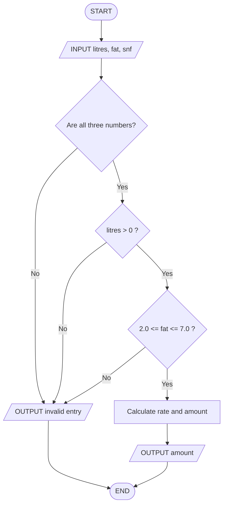

# Task 8 – Plan the Algorithm Before Coding (K3)

**Run:** `python trace.py` (prints the hand-trace table by program) and `python alternatives.py`
(The flowchart below uses Mermaid; in VS Code press `Ctrl+Shift+V` to preview – install the extension *Markdown Preview Mermaid Support* – or use the text version.)

## Steps of algorithmic problem solving
1. **Understand** – inputs (litres, fat, snf), outputs (rate, amount, ten-day total), rules (Task 1).
2. **Plan** – pseudocode + flowchart (below), written *before* the Python code.
3. **Write** – translate each line to Python (`Task06/functions.py`, `Task09/calculator.py`).
4. **Test** – assert tests and a hand-calculated set (Task 9).

## Pseudocode – one payment
```
ALGORITHM OnePayment
START
INPUT litres, fat, snf
SET fat_steps TO round of (fat - 3.5) divided by 0.1
SET snf_steps TO round of (snf - 8.5) divided by 0.1
SET rate TO 30.00 + fat_steps * 0.40 + snf_steps * 0.30
SET rate TO rate rounded to 2 decimals
SET amount TO litres * rate, rounded to 2 decimals
OUTPUT rate, amount
END
```

## Pseudocode – ten-day total for one farmer
```
ALGORITHM TenDayTotal
START
SET total TO 0
FOR each entry IN the farmer's entries for ten days
    IF litres > 0 AND 2.0 <= fat <= 7.0 THEN
        SET amount TO payment of entry (OnePayment)
        SET total TO total + amount
    ELSE
        OUTPUT "invalid entry"
    ENDIF
ENDFOR
OUTPUT total
END
```

## Flowchart – validating one entry

Text version: START → read litres, fat, snf → numbers? (no → "invalid") → litres > 0? (no → "invalid") → fat between 2.0 and 7.0? (no → "invalid") → calculate rate and amount → show amount → END.

## Hand trace (matches `trace.py`)
| # | litres | fat | snf | valid? | fat_steps | snf_steps | rate | amount | total |
|---|---|---|---|---|---|---|---|---|---|
| start | | | | | | | | | 0.00 |
| 1 | 10 | 3.5 | 8.5 | yes | 0 | 0 | 30.00 | 300.00 | 300.00 |
| 2 | 8.5 | 4.2 | 8.7 | yes | 7 | 2 | 30+2.80+0.60 = 33.40 | 283.90 | 583.90 |
| 3 | 12 | 3.1 | 8.3 | yes | −4 | −2 | 30−1.60−0.60 = 27.80 | 333.60 | 917.50 |
| 4 | −5 | 4.0 | 8.5 | **no** | – | – | – | – | 917.50 |
OUTPUT 917.50 (with "invalid entry" for #4).

## Alternative concept: store all entries in a list, or keep a running total
```
List version                          Running-total version
SET amounts TO empty list             SET total TO 0
FOR each entry                        FOR each entry
    ADD payment TO amounts                SET total TO total + payment
ENDFOR                                ENDFOR
SET total TO sum of amounts           OUTPUT total
```
- Time: **O(n)** in both (each entry is processed once).
- Space: list version **O(n)**, running total **O(1)** – measured peak memory for 150,000 entries: ~16 MB vs ~1 KB.
- Storing the entries is still necessary when you need them later: printing a statement per payment, re-checking or correcting an entry, sorting/finding the highest, applying a rule that needs the whole period (the **bonus on >500 litres of Task 12**, where the total litres must be known before deciding), or producing audit/bank files.
